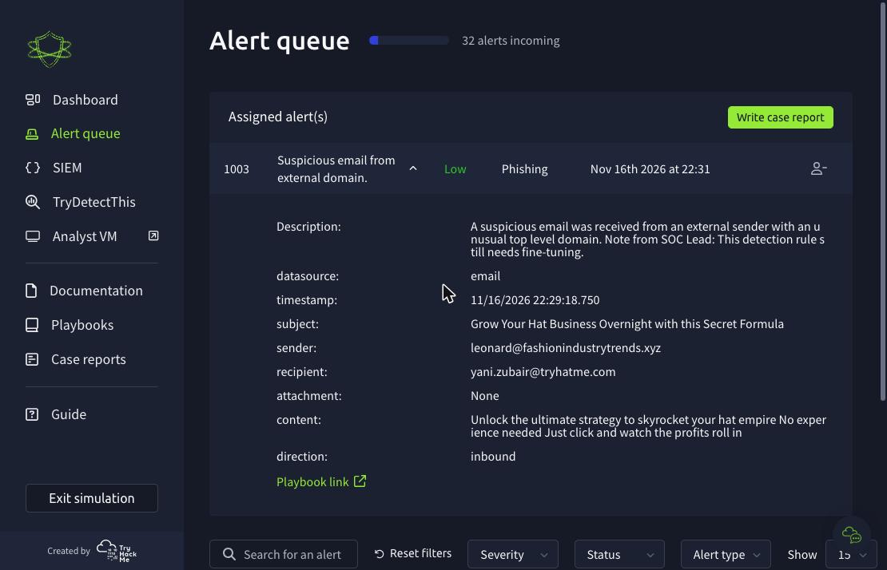
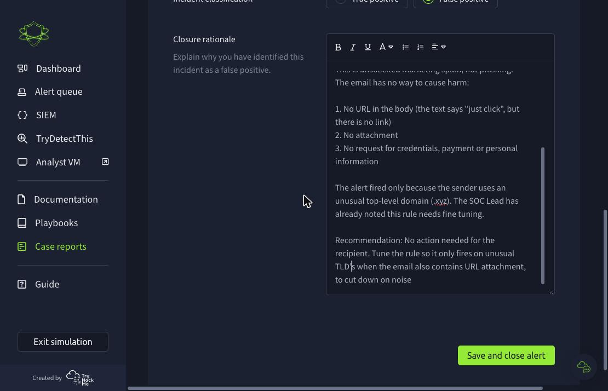

# Phishing Unfolding: Live Phishing Attack Investigation

| Field | Detail |
|---|---|
| **Platform** | TryHackMe SOC Simulator, *Phishing Unfolding* (Medium) |
| **Date** | 2026-11-16 |
| **Tools** | Splunk, SOC Simulator alert queue & case reporting |
| **Data sources** | Email gateway logs, process creation logs, network/DNS logs |
| **Alerts in scope** | 36 |
| **Role supported** | SOC Analyst · Incident Responder |

> Lab environment with simulated data, done for training. Screenshots are cleaned up: no flags, answers or secrets.

---

## Case Study at a Glance
- **Problem:** _in progress_
- **Action:** _in progress_
- **Outcome:** _in progress_

**Takeaway:** _in progress_

## 1. Summary
_Written once the investigation is complete._

## 2. Scenario & Scope
A phishing attack played out in real time across the TryHatMe corporate network, producing 36 alerts across phishing, process and execution detections. My job was to triage every alert, separate the noise from the real attack, document key events (PowerShell execution, reverse shell connections, suspicious DNS requests), and write case reports covering the full scope of the breach.

## 3. Alert Triage

### Triage log
| Alert | Rule | Severity | Verdict | Reason |
|---|---|---|---|---|
| 1003 | Suspicious email from external domain | Low | False Positive | Marketing spam with no link, attachment or credential request |

### Example: separating spam from phishing (Alert 1003)

**What fired:** An inbound email from `leonard@fashionindustrytrends.xyz` to `yani.zubair@tryhatme.com` with the subject *"Grow Your Hat Business Overnight with this Secret Formula."* The rule flags senders with unusual top-level domains.

**How I evaluated it:** I asked what the email could actually *do* to the recipient:
- The body says "just click", but it contains **no URL**
- There's **no attachment**
- It asks for **no credentials, payment or personal information**

**My case report:**

**Verdict:** False Positive. This is unwanted marketing spam, not phishing. It has no way to cause harm. The alert fired on the `.xyz` domain alone, and the SOC Lead had already flagged this rule as noisy.

**Recommendation:** No action needed for the recipient. I recommended tuning the rule so it only alerts on unusual TLDs when the email *also* contains a URL or attachment. That would cut this class of false positive without missing real phishing.

## 4. Attack Chain Investigation
_In progress._

## 5. Indicators of Compromise
| Type | Value | Context |
|---|---|---|

## 6. MITRE ATT&CK Mapping
| Tactic | Technique | ID | Evidence |
|---|---|---|---|

## 7. Timeline
| Time (UTC) | Event |
|---|---|

## 8. Verdict & Response
_In progress._

## 9. Lessons Learned
- **Not every alert is an attack.** Triage starts with "what can this actually do?" Spam and phishing can trigger the same rule, but only one of them needs a response.
- **Noisy rules cost analyst time.** Documenting a tuning recommendation alongside the false positive helps the whole team.
